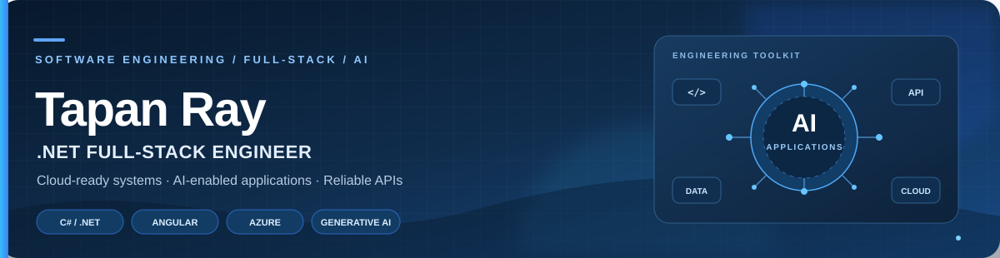
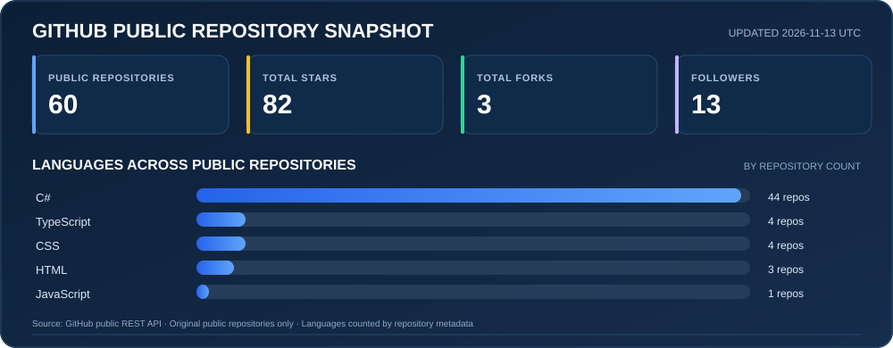
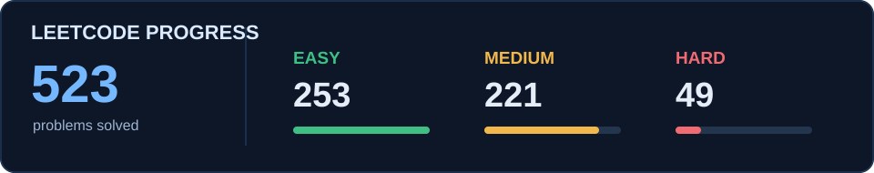

 alt="Tapan Ray — .NET Full-Stack Engineer"/>

 

 

---

## 👨‍💻 About Me

I'm a **.NET Full-Stack Engineer** focused on building maintainable enterprise applications, reliable backend services, and cloud-ready systems. I work across API, data, frontend, and deployment layers—and I'm actively exploring how Generative AI and agentic workflows can improve real-world software.

- **Backend:** C#, .NET, ASP.NET Core, REST APIs, EF Core, ADO.NET, LINQ
- **Frontend:** Angular, TypeScript, React, JavaScript
- **Data:** SQL Server, T-SQL, relational modelling, query optimization, Redis
- **Cloud & DevOps:** Microsoft Azure, Azure DevOps, Docker, Kubernetes, CI/CD
- **AI engineering:** LLMs, RAG, prompt engineering, tool calling, MCP, Semantic Kernel
- **Problem solving:** 500+ LeetCode problems · LeetCode Knight · CodeChef 3-Star

> I enjoy understanding systems end to end: from a clean API contract and an efficient query to a responsive UI and a reliable deployment.

## 🧭 Engineering Focus

<table>
<tr>
<td width="50%" valign="top">

### ⚙️ Backend & Architecture
- ASP.NET Core Web API
- Clean Architecture and SOLID
- Dependency Injection and middleware
- Authentication and authorization
- EF Core, ADO.NET, LINQ
- API performance and exception handling

</td>
<td width="50%" valign="top">

### 🖥️ Frontend Engineering
- Angular and TypeScript
- RxJS and reactive patterns
- Reusable component design
- State and form management
- React and modern JavaScript
- API integration and responsive UI

</td>
</tr>
<tr>
<td width="50%" valign="top">

### ☁️ Cloud & Reliability
- Azure App Service and Azure SQL
- Azure Functions and Storage
- Azure DevOps and CI/CD
- Docker and Kubernetes
- Logging, monitoring and diagnostics
- Production support and troubleshooting

</td>
<td width="50%" valign="top">

### 🧠 Data, AI & Distributed Systems
- SQL performance and indexing
- ETL / ELT and data pipelines
- Caching and distributed systems
- Generative AI and LLM integration
- RAG, agents and tool calling
- System design and scalability

</td>
</tr>
</table>

## 🛠️ Technology Stack

**Languages**

**Backend & Frontend**

**Databases, Cloud & Tools**

**Also working with:** ASP.NET Core · Web API · EF Core · ADO.NET · Dapper · LINQ · T-SQL · RxJS · Azure DevOps · GitHub Actions · SonarQube

---

## 💼 Professional Experience

### EY — Advanced Analyst
**November 2026 – Present**

- Joined EY as an Advanced Analyst.
- Continuing to grow across enterprise delivery, collaboration, and technology-driven business solutions.

### LTIMindtree — Software Engineer
**May 2025 – November 2026 · Bengaluru, India**

Contributed to enterprise application development and application maintenance across backend engineering, API development, database access, cloud integration, and production support.

- Developed and maintained REST APIs using **C# and ASP.NET Core**.
- Implemented modular backend functionality and application workflows.
- Worked with **SQL Server, EF Core, ADO.NET, and LINQ** for data access.
- Investigated production issues using logs, SQL diagnostics, Azure Portal, and Application Insights.
- Contributed to a bug-management automation system and supported API-driven workflows.
- Collaborated with QA, business, and engineering teams in delivery and support cycles.

**Technologies:** C# · ASP.NET Core · REST APIs · SQL Server · EF Core · ADO.NET · LINQ · Azure · Azure DevOps

### Nokia — React Developer, R&D Intern
**August 2023 – April 2024 · Bengaluru, India**

Worked on the Customer Insights platform with a focus on frontend engineering.

- Developed reusable UI components using React.js and JavaScript.
- Implemented responsive layouts and REST API integration.
- Improved frontend code quality through debugging, refactoring, and SonarQube analysis.
- Collaborated with cross-functional teams in an Agile environment.

**Technologies:** React.js · JavaScript · HTML5 · CSS3 · REST APIs · Git · SonarQube

### Celebal Technologies — React Developer Intern
**June 2023 – August 2023**

- Built reusable React components and interactive interfaces.
- Worked with React Hooks, props, and state.
- Integrated REST APIs into frontend workflows.

**Technologies:** React.js · JavaScript · HTML5 · CSS3 · REST APIs · Git

---

## 🚀 Selected Projects

<table>
<tr>
<td width="50%" valign="top">

### [FlowOps](https://github.com/tapan0810/FlowOps)

Enterprise-oriented Angular application.

**Focus:** Angular architecture, TypeScript, reusable components, and maintainable frontend engineering.

</td>
<td width="50%" valign="top">

### [Student Full-Stack API](https://github.com/tapan0810/DotNet_Angular_App_1_StudentAPI)

Full-stack student management application.

**Stack:** ASP.NET Core · EF Core · Angular · TypeScript · SQL Server

</td>
</tr>
<tr>
<td width="50%" valign="top">

### [GitHub Analytics Pro](https://github.com/tapan0810/github-analytics-pro)

GitHub analytics and data presentation project.

**Focus:** Repository insights, analytics UI, and visualizing developer activity.

</td>
<td width="50%" valign="top">

### [ResumeIQ AI](https://github.com/tapan0810/ResumeIQ-AI)

AI-oriented resume application.

**Focus:** Resume workflows and practical AI application development.

</td>
</tr>
</table>

---

## 📊 GitHub Analytics

Generated daily from GitHub's public REST API. Language distribution is counted by repository primary language, not by source-code bytes.

---

## 🐍 Contribution Activity

<picture>
  <source media="(prefers-color-scheme: dark)" srcset="https://raw.githubusercontent.com/tapan0810/tapan0810/main/assets/github-snake-dark.svg"/>
  <source media="(prefers-color-scheme: light)" srcset="https://raw.githubusercontent.com/tapan0810/tapan0810/main/assets/github-snake.svg"/>
  
</picture>

---

## 🧩 LeetCode Progress

  

## 🏅 Certifications & Achievements

- Microsoft Certified: Azure Fundamentals (AZ-900)
- Claude Certified Architect — Foundations
- Claude Certified Developer — Foundations
- Claude Certified Architect — Professional
- LeetCode Knight · 500+ problems solved
- CodeChef · 3-Star
- Built 50+ development projects

## 📚 Current Learning Roadmap

| Area | Focus |
|---|---|
| .NET | Advanced ASP.NET Core, performance, testing, architecture |
| Angular | Enterprise Angular, RxJS, state management |
| Cloud | Azure services, deployment, monitoring, CI/CD |
| Distributed Systems | Messaging, caching, resilience, partitioning, sharding |
| AI Engineering | LLM integration, RAG, evaluation, agentic workflows |
| System Design | Scalability, reliability, observability, trade-offs |

---

## 🤝 Let's Connect

  

**Building useful software · Learning continuously · Shipping with purpose**

