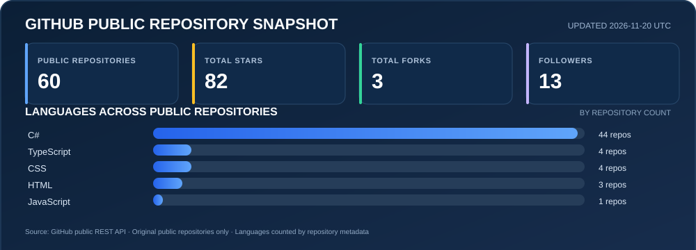

 

  

  <strong>Software Engineering</strong> &nbsp; · &nbsp;
  <strong>.NET & Cloud</strong> &nbsp; · &nbsp;
  <strong>Full-Stack Development</strong> &nbsp; · &nbsp;
  <strong>AI Engineering</strong>

## 👋 About Me

I'm a software engineer interested in designing and building dependable, maintainable applications. My experience spans backend development, frontend engineering, relational databases, cloud integration, and enterprise application support.

I primarily work with **C#, ASP.NET Core, Angular, SQL Server, and Microsoft Azure**. I enjoy understanding systems end to end—from API design and data access to user experience, deployment, and production troubleshooting. I'm also exploring how Generative AI and agentic workflows can be applied to practical software products.

- 💼 **Currently:** Advanced Analyst at EY
- 🧩 **Core engineering focus:** .NET, Angular, SQL Server, and Azure
- 🧠 **Exploring:** Generative AI, RAG, agentic applications, and system design
- 🏅 **Problem solving:** 500+ LeetCode problems · CodeChef 3-Star

## 🧰 Technical Skills

| Area | Technologies |
|---|---|
| Languages | C#, JavaScript, TypeScript, C++, Python, Java |
| Backend | .NET, ASP.NET Core Web API, Entity Framework Core, ADO.NET, LINQ |
| Frontend | Angular, RxJS, React, HTML5, CSS3 |
| Databases | Microsoft SQL Server, MySQL, Redis |
| Cloud & DevOps | Microsoft Azure, Azure DevOps, GitHub Actions, Docker, Kubernetes |
| Engineering practices | REST APIs, OOP, SOLID, design patterns, testing, debugging, CI/CD |
| AI & data interests | Generative AI, LLM integration, RAG, agentic workflows, data engineering |

## 💼 Professional Experience

### EY — Advanced Analyst
**November 2026 – Present**

Working as an Advanced Analyst in EY's Tax practice. Building domain knowledge, collaborating with stakeholders, and contributing to enterprise delivery.

### LTIMindtree — Software Engineer
**April 2025 – November 2026 · Bengaluru, India**

Worked on enterprise application development and application maintenance for the OPENLANE account.

- Developed and maintained REST APIs using **C# and ASP.NET Core**.
- Implemented backend workflows and data-access functionality.
- Worked with **SQL Server, Entity Framework Core, ADO.NET, and LINQ**.
- Supported Azure-integrated application environments and deployment workflows.
- Investigated production defects, analyzed logs and SQL behavior, and collaborated with cross-functional teams to resolve issues.

**Technologies:** C# · ASP.NET Core · Angular · SQL Server · EF Core · ADO.NET · Azure · Azure DevOps

### Nokia — Research & Development Intern
**August 2023 – April 2024 · Customer Insights**

Contributed to the frontend of Nokia's Customer Insights product.

- Developed and maintained user-interface components using **React and JavaScript**.
- Integrated frontend workflows with backend services.
- Worked in a product environment involving data ingestion and processing technologies.
- Collaborated with engineers to debug, refine, and improve application functionality.

**Technologies:** React · JavaScript · HTML · CSS · REST APIs · Git

### Celebal Technologies — React Developer Intern
**April 2023 – June 2023**

- Built reusable React components and interactive user interfaces.
- Practised component-based development, React Hooks, and state management.
- Integrated REST APIs into frontend workflows.

**Technologies:** React · JavaScript · HTML · CSS · Git

## 🚀 Featured Projects

A selection of projects that reflect my interests in backend engineering, full-stack development, AI, and developer tooling.

<table>
<tr>
<td width="50%" valign="top">

### [FlowOps](https://github.com/tapan0810/FlowOps)

**Angular · TypeScript**

An enterprise-oriented frontend project focused on structured application architecture, reusable components, and maintainable UI development.

</td>
<td width="50%" valign="top">

### [Student Full-Stack Application](https://github.com/tapan0810/DotNet_Angular_App_1_StudentAPI)

**ASP.NET Core · Angular · EF Core · SQL Server**

A full-stack student management application with REST APIs and an Angular frontend.

</td>
</tr>
<tr>
<td width="50%" valign="top">

### [ResumeIQ AI](https://github.com/tapan0810/ResumeIQ-AI)

**AI application**

An AI-focused project exploring practical resume analysis and review workflows.

</td>
<td width="50%" valign="top">

### [GitHub Analytics Pro](https://github.com/tapan0810/github-analytics-pro)

**JavaScript · GitHub REST API**

A dashboard for exploring GitHub profile and repository insights, language distribution, and repository health.

[Live demo](https://github-analytic-pro.netlify.app/)

</td>
</tr>
<tr>
<td width="50%" valign="top">

### [OrgSphere](https://github.com/tapan0810/OrgSphere)

**Software application**

An application project in my portfolio focused on building practical software solutions.

</td>
<td width="50%" valign="top">

### More projects

I work on projects across .NET APIs, Angular, system design, data analysis, and developer tools.

[Explore all repositories →](https://github.com/tapan0810?tab=repositories)

</td>
</tr>
</table>

## 🏅 Certifications & Achievements

### Certifications
- Microsoft Certified: **Fabric Data Engineer Associate**
- Microsoft Certified: **Azure Fundamentals (AZ-900)**
- Claude Certified Architect — Foundations
- Claude Certified Developer — Foundations
- Claude Certified Architect — Professional

### Problem Solving & Development
- **500+** problems solved on LeetCode
- **LeetCode Knight**
- **3-Star** on CodeChef
- Built **50+** development projects

## 📚 Currently Exploring

- Advanced ASP.NET Core, application architecture, and performance
- Enterprise Angular, RxJS, and frontend architecture
- Azure services, cloud deployment, and observability
- Distributed systems, messaging, caching, and resilience
- Generative AI, RAG, and agentic application patterns
- System design and engineering trade-offs

## 📊 GitHub Activity

 

<a href="https://github.com/tapan0810?tab=repositories">Explore my repositories</a>

  

  

  

<picture>
  <source media="(prefers-color-scheme: dark)" srcset="https://raw.githubusercontent.com/tapan0810/tapan0810/main/assets/github-snake-dark.svg"/>
  <source media="(prefers-color-scheme: light)" srcset="https://raw.githubusercontent.com/tapan0810/tapan0810/main/assets/github-snake.svg"/>
  
</picture>

## 🎓 Education

- **Master of Computer Applications (MCA)** — KIIT, Bhubaneswar · 2024
- **B.Sc. Computer Science** — Khallikote Autonomous College · 2022

## 🤝 Let's Connect

I'm always interested in connecting with engineers, exchanging ideas, and discussing software engineering, cloud technologies, and AI.

  

**Building useful software · Learning continuously · Solving meaningful problems**

