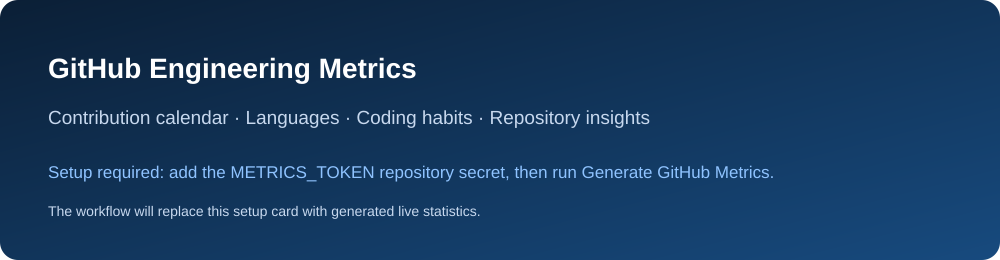

  

 

---

## 👋 About Me

I'm a **.NET Full-Stack Engineer and AI application development enthusiast** focused on building maintainable enterprise software and exploring practical ways to integrate intelligent capabilities into applications.

My core engineering stack includes **C#, .NET, ASP.NET Core, Angular, TypeScript, and Microsoft SQL Server**. I also work with cloud and DevOps tooling, and continuously explore Generative AI, LLMs, RAG, and agentic application patterns.

- Build full-stack applications using **C#, ASP.NET Core, Angular, and TypeScript**.
- Design and maintain REST APIs, service layers, validation, and authentication workflows.
- Work with **SQL Server, EF Core, ADO.NET, LINQ, and query optimization**.
- Develop and explore cloud solutions using **Microsoft Azure, Docker, and CI/CD**.
- Explore **Generative AI, LLMs, RAG, Agentic AI, MCP, and Semantic Kernel**.
- Interested in **ETL/ELT, data pipelines, distributed systems, and system design**.
- **LeetCode Knight · 500+ problems solved · CodeChef 3-Star · 50+ development projects**.

> **My engineering focus:** Full-stack product development · Cloud-ready systems · AI-enabled application patterns.

---

## 🧭 Engineering Focus

<table>
<tr>
<td width="50%" valign="top">

### 🌐 .NET Full-Stack Engineering

- C# and modern .NET
- ASP.NET Core Web API
- Angular and TypeScript
- Entity Framework Core
- ADO.NET, Dapper, and LINQ
- SQL Server and T-SQL
- Clean Architecture and SOLID
- JWT authentication and authorization
- REST API design and integration

</td>
<td width="50%" valign="top">

### 🧠 AI Application Development

- Generative AI and LLM fundamentals
- Prompt engineering
- Retrieval-Augmented Generation (RAG)
- Agentic AI patterns and tool calling
- Multi-agent system concepts
- Model Context Protocol (MCP)
- Microsoft Semantic Kernel
- LLM integration and evaluation

</td>
</tr>
<tr>
<td width="50%" valign="top">

### ☁️ Cloud, DevOps & Reliability

- Microsoft Azure
- Azure App Services and Azure SQL
- Azure Functions and Azure DevOps
- Docker and Kubernetes
- CI/CD pipelines
- Application Insights and diagnostics
- Production troubleshooting

</td>
<td width="50%" valign="top">

### 📊 Data & Problem Solving

- SQL and database optimization
- ETL / ELT concepts
- Data processing and pipeline design
- Relational data modeling
- Data Structures and Algorithms
- Complexity analysis
- LeetCode and competitive programming

</td>
</tr>
</table>

---

## 🛠️ Technology Stack

**Languages**

**Backend & Frameworks**

ASP.NET Core · Web API · EF Core · ADO.NET · Dapper · LINQ · REST APIs

**Frontend**

**Databases**

SQL Server · T-SQL · Stored Procedures · Indexing · Query Optimization

**Cloud, DevOps & Tools**

**AI Engineering Topics**

---

## 💼 Professional Experience

### EY — Advanced Analyst
**November 2026 – Present**

- Joined EY as an Advanced Analyst.
- Continuing to build experience in enterprise delivery, collaboration, and technology-driven business solutions.

### LTM (LTIMindtree) — Software Engineer
**May 2025 – November 2026 · Bengaluru, India**

Contributed to enterprise application development and application maintenance, with work spanning backend engineering, API development, database access, cloud integration, and production support.

**Application Engineering**
- Developed and maintained REST APIs using **C# and ASP.NET Core**.
- Implemented backend functionality using modular application structures and established development patterns.
- Worked with **SQL Server, Entity Framework Core, ADO.NET, and LINQ** for data access.
- Worked on SQL queries and stored procedures to support application requirements and performance.
- Investigated production issues using application logs, SQL diagnostics, Azure Portal, and Application Insights.
- Collaborated with QA, business, and engineering teams during development and support cycles.

**Bug Automation System**
- Worked on a system that automated parts of the bug-management workflow.
- Contributed to backend functionality and API-based application workflows.
- Worked with C#, ASP.NET Core, SQL Server, REST APIs, and Azure in the wider application environment.
- Supported production troubleshooting and defect investigation using logs, SQL, Azure Portal, and Application Insights.

**Technologies:** C#, ASP.NET Core, REST APIs, SQL Server, EF Core, ADO.NET, LINQ, Microsoft Azure, Azure DevOps, Docker, Kubernetes, Git, Agile.

### Nokia — React Developer, R&D Intern
**August 2023 – April 2024 · Bengaluru, India**

Worked on the Customer Insights platform with a focus on frontend engineering and modern web application development.

- Developed reusable UI components using React.js and JavaScript.
- Implemented responsive layouts, routing, state management, and REST API integration.
- Optimized frontend rendering and application performance.
- Improved code quality through SonarQube analysis, debugging, and refactoring.
- Collaborated with cross-functional teams in an Agile environment.
- Worked with Docker and Kubernetes-based deployment workflows.

**Technologies:** React.js, JavaScript, HTML5, CSS3, REST APIs, Git, SonarQube, Docker, Kubernetes.

### Celebal Technologies — React Developer
**June 2023 – August 2023**

- Developed reusable React components and interactive interfaces.
- Worked with React Hooks, props, and state management.
- Integrated REST APIs into dynamic frontend workflows.
- Implemented responsive layouts and maintainable UI components.

**Technologies:** React.js, JavaScript, HTML5, CSS3, REST APIs, Git, GitHub.

---

## 🚀 Featured Projects

<table>
<tr>
<td width="50%" valign="top">

### [FlowOps](https://github.com/tapan0810/FlowOps)

Enterprise-oriented Angular project.

**Focus:** Angular application structure, TypeScript, reusable UI, and frontend engineering.

</td>
<td width="50%" valign="top">

### [Student Full-Stack API](https://github.com/tapan0810/DotNet_Angular_App_1_StudentAPI)

Full-stack student management application.

**Stack:** ASP.NET Core, Entity Framework Core, Angular, TypeScript, SQL Server.

</td>
</tr>
<tr>
<td width="50%" valign="top">

### [GitHub Analytics Pro](https://github.com/tapan0810/github-analytics-pro)

GitHub analytics project.

**Focus:** Repository insights, analytics-oriented UI, and data presentation.

</td>
<td width="50%" valign="top">

### [ResumeIQ AI](https://github.com/tapan0810/ResumeIQ-AI)

AI-oriented application project.

**Focus:** Resume-related application development and AI exploration.

</td>
</tr>
</table>

**More repositories:** [Explore all my GitHub projects](https://github.com/tapan0810?tab=repositories).

---

## 🏗️ Architecture & Engineering Notes

I use architecture diagrams and implementation notes to document how application components interact. The diagrams below are conceptual learning/reference architectures, not claims about a specific employer's internal implementation.

### .NET Web API — Layered Request Flow

~~~mermaid
flowchart TD
    A[Client / Angular UI] --> B[ASP.NET Core API]
    B --> C[Middleware / Authentication / Validation]
    C --> D[Controller / Endpoint]
    D --> E[Application Service]
    E --> F[Domain Rules]
    E --> G[Infrastructure / Repository]
    G --> H[(SQL Server)]
    E --> I[DTO / API Response]
    I --> B
    B --> A
~~~

### RAG — AI Application Pattern

~~~mermaid
flowchart TD
    A[User Question] --> B[Application API]
    B --> C[Query Processing]
    C --> D[Embedding / Retrieval]
    D --> E[(Vector Store)]
    E --> F[Relevant Context]
    F --> G[LLM]
    G --> H[Grounded Response]
    H --> B
    B --> A
~~~

### Event-Driven Processing — Conceptual Pattern

~~~mermaid
flowchart LR
    A[API / Event Producer] --> B[Message Broker]
    B --> C[Background Worker]
    C --> D[Business Processing]
    D --> E[(Database)]
    D --> F[Logs / Monitoring]
~~~

---

## 🏅 Certifications & Achievements

- **Microsoft Certified: Azure Fundamentals (AZ-900)**
- **Claude Certified Architect – Foundations**
- **Claude Certified Developer – Foundations**
- **Claude Certified Architect – Professional**
- **LeetCode Knight** — 500+ problems solved
- **CodeChef** — 3-Star Programmer
- Built **50+ development projects**

---

## 📚 Current Learning Roadmap

| Domain | Current focus |
|---|---|
| .NET | Advanced ASP.NET Core, performance, testing, architecture |
| Angular | Enterprise Angular, RxJS, state management, application design |
| Cloud | Azure services, deployment, monitoring, CI/CD |
| Distributed Systems | Messaging, caching, resilience, partitioning, sharding |
| AI Engineering | LLM integration, RAG, prompt design, evaluation |
| Agentic AI | Tool calling, orchestration, MCP, Semantic Kernel |
| Data Engineering | ETL/ELT, data pipelines, SQL performance |
| System Design | Scalability, reliability, observability, trade-offs |

---

## 🧩 LeetCode Progress

  

Compact live LeetCode solved counts by difficulty, generated from the public profile **tapan-ray**.

[View my LeetCode profile](https://leetcode.com/u/tapan-ray/)

---

## 📊 GitHub Metrics

The GitHub habits plugin reflects public GitHub contribution patterns and commit activity. It does not measure editor time or time spent coding in an IDE.

[View GitHub activity](https://github.com/tapan0810)

<strong>Additional GitHub statistics</strong>

  

  

---

## 🐍 Contribution Activity

<picture>
  <source media="(prefers-color-scheme: dark)" srcset="./assets/github-snake-dark.svg"/>
  <source media="(prefers-color-scheme: light)" srcset="./assets/github-snake.svg"/>
  
</picture>

---

## 🤝 Connect With Me

  

**Building full-stack products · Exploring intelligent systems · Engineering practical solutions**

